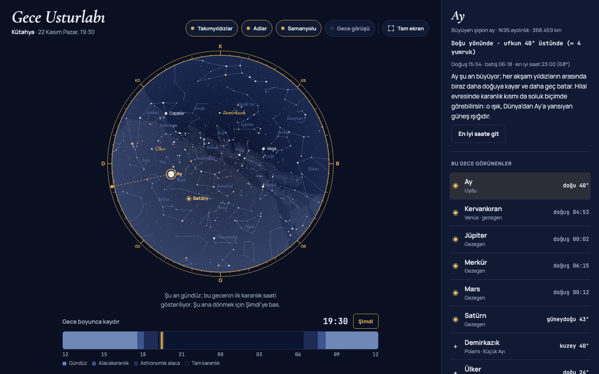

**English** · [Türkçe](README.tr.md)

# Gece Usturlabı (Night Astrolabe)

A night sky map for Turkey: pick any of the 81 provinces (or your own coordinates) and see which stars, planets and constellations are up tonight, with Turkish folk star names and short stories.

<p align="center"></p>

No installation: download the repository and double-click `index.html`. Everything (star catalogue included) is inside that one file; only the fonts come from the internet, with fallbacks if you are offline.

## What it does

- **Sky dome for any night:** 2,309 stars down to magnitude 5.3, 88 constellations with their official Turkish names, the Milky Way, the Sun, the Moon with its phase, and Mercury to Saturn. North is up and east is on the left, so the map matches the sky when you hold your phone above your head.
- **Time strip:** drag through the night from noon to noon. The strip's colours are that night's real twilight phases (day, civil, astronomical, full dark).
- **Visible tonight:** a list with each object's direction, altitude, rise/set time and best viewing hour. Altitude is also given in "fists" (an outstretched fist covers about 10°).
- **Tap for a story:** Polaris is *Demirkazık* (the "iron stake" the sky turns around), the Pleiades are *Ülker*, Venus is *Çoban Yıldızı* in the evening and *Kervankıran* in the morning, switched automatically.
- **Night vision mode:** everything turns red, like an astronomer's red torch, so your eyes stay dark-adapted.
- **Full screen** for looking up outside, **light / dark themes**, works on phones (tap or drag anywhere on the time strip).

## Design

The visual language is built around an **astrolabe**: a brass ring engraved every 5° around the horizon, dashed altitude circles (almucantars), and a brass pointer from the selected object to its compass bearing, inspired by the star pointers on an astrolabe's rete. The light theme reads like a printed star atlas; the dark theme is night blue with brass.

## Technical

- Plain HTML, CSS and JavaScript on a `<canvas>`; no framework, no build step needed to run it.
- Stereographic projection centred on the zenith.
- Sun, Moon and planet positions from Paul Schlyter's orbital elements, with the main lunar perturbation terms and lunar parallax; planet magnitudes from the same method. Accuracy is a few arcminutes for planets, which is plenty for naked-eye use. Stars are J2000 positions (no precession, ~0.4° today).
- Times are shown in the device's time zone.

### Rebuilding

```bash
python3 tools/build.py            # src/app.html + src/sky-data.js -> index.html
python3 tools/make_data.py <d3-celestial>/data   # regenerate src/sky-data.js
```

## Credits

Star, constellation and Milky Way data: [d3-celestial](https://github.com/ofrohn/d3-celestial) by Olaf Frohn, BSD 3-Clause licence (see [`third_party/d3-celestial-LICENSE.txt`](third_party/d3-celestial-LICENSE.txt)).
