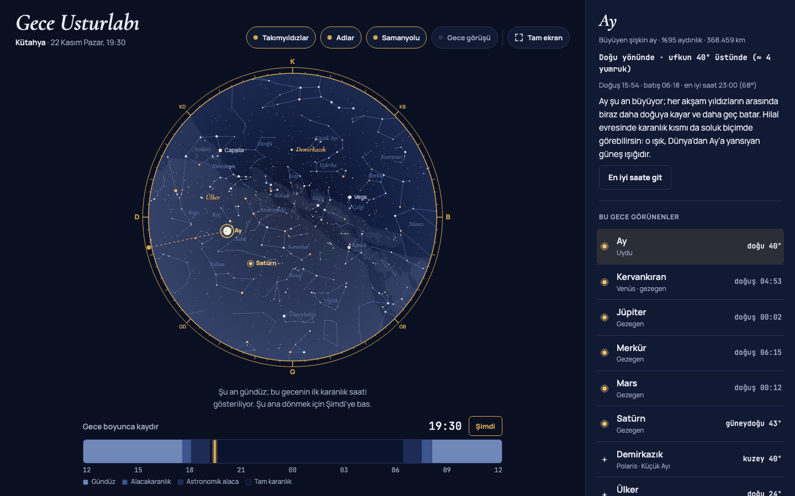

[English](README.md) · **Türkçe**

# Gece Usturlabı

Türkiye için bir gece gökyüzü haritası: 81 ilden birini (ya da kendi koordinatını) seç, o gece hangi yıldızların, gezegenlerin ve takımyıldızların görüneceğini Türkçe halk adları ve kısa hikâyeleriyle gör.

<p align="center"></p>

Kurulum yok: depoyu indir, `index.html` dosyasına çift tıkla. Yıldız kataloğu dahil her şey bu tek dosyanın içinde; yalnız yazı tipleri internetten gelir, internet yoksa yedek yazı tipleri kullanılır.

## Neler yapıyor

- **Her gece için gökkubbe:** 5,3 kadire kadar 2.309 yıldız, resmi Türkçe adlarıyla 88 takımyıldız, Samanyolu, Güneş, evresiyle Ay ve Merkür'den Satürn'e gezegenler. Üst kuzey, sol doğu; telefonu başının üstüne kaldırınca harita gökle eşleşir.
- **Zaman şeridi:** gece boyunca öğleden öğleye kaydır. Şeridin renkleri o gecenin gerçek alacakaranlık evreleridir (gündüz, sivil, astronomik, tam karanlık).
- **Bu gece görünenler:** her cismin yönü, yüksekliği, doğuş/batış saati ve en iyi gözlem saati. Yükseklik "yumruk" olarak da verilir (kol boyu uzatılmış yumruk ≈ 10°).
- **Dokun, hikâyesini oku:** Kutup Yıldızı *Demirkazık*, Pleiades *Ülker*; Venüs akşam göğündeyken *Çoban Yıldızı*, sabah göğündeyken *Kervankıran* olarak kendiliğinden değişir.
- **Gece görüşü modu:** gökbilimcilerin kırmızı feneri gibi her şey kırmızıya döner, göz karanlığa alışkın kalır.
- Dışarıda bakmak için **tam ekran**, **açık / koyu tema**, telefonda çalışır (zaman şeridinin her yerine dokunup sürüklenebilir).

## Tasarım

Görsel dil bir **usturlap** üzerine kurulu: ufuk çevresinde 5°'de bir çentikli pirinç halka, kesikli yükseklik daireleri (almukantarlar) ve seçilen cisimden pusula yönüne uzanan pirinç bir iğne (usturlap retesindeki yıldız işaretçilerinden esinlenildi). Açık tema basılı bir yıldız atlası gibi, koyu tema gece mavisi ve pirinç.

## Teknik

- Saf HTML, CSS ve JavaScript, çizim `<canvas>` üzerinde; çatı (framework) yok, çalıştırmak için derleme gerekmez.
- Başucu merkezli stereografik izdüşüm.
- Güneş, Ay ve gezegen konumları Paul Schlyter'in yörünge öğelerinden; Ay'ın başlıca bozulma terimleri ve paralaksıyla. Gezegenlerde doğruluk birkaç yay dakikası, çıplak göz için fazlasıyla yeterli. Yıldızlar J2000 konumunda (presesyon yok, bugün ~0,4°).
- Saatler cihazın saat dilimine göre gösterilir.

### Yeniden derleme

```bash
python3 tools/build.py            # src/app.html + src/sky-data.js -> index.html
python3 tools/make_data.py <d3-celestial>/data   # src/sky-data.js'i yeniden üret
```

## Teşekkür

Yıldız, takımyıldız ve Samanyolu verisi: Olaf Frohn'un [d3-celestial](https://github.com/ofrohn/d3-celestial) projesi, BSD 3-Clause lisansı ([`third_party/d3-celestial-LICENSE.txt`](third_party/d3-celestial-LICENSE.txt)).
